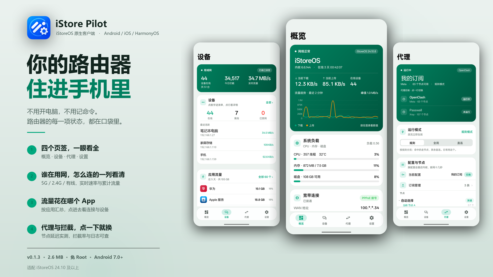
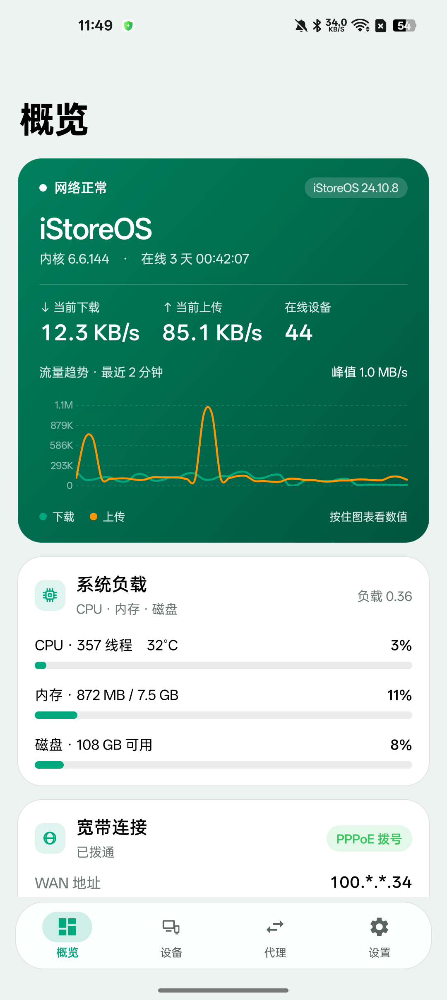
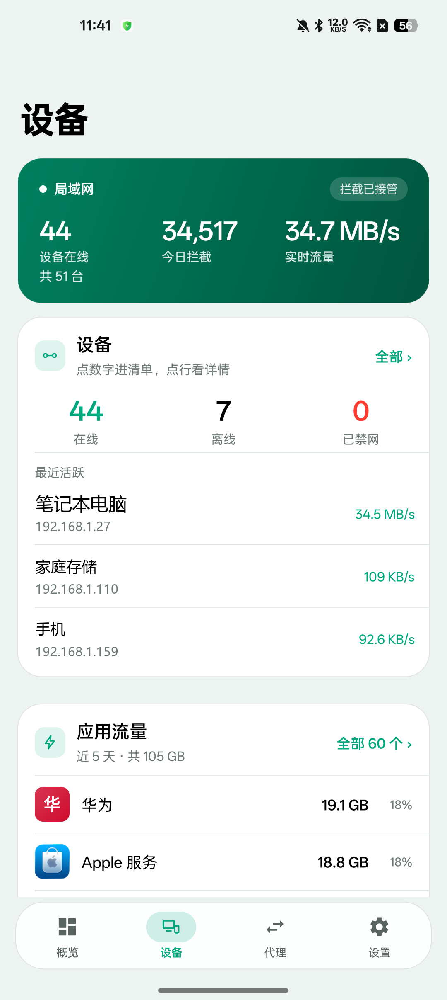
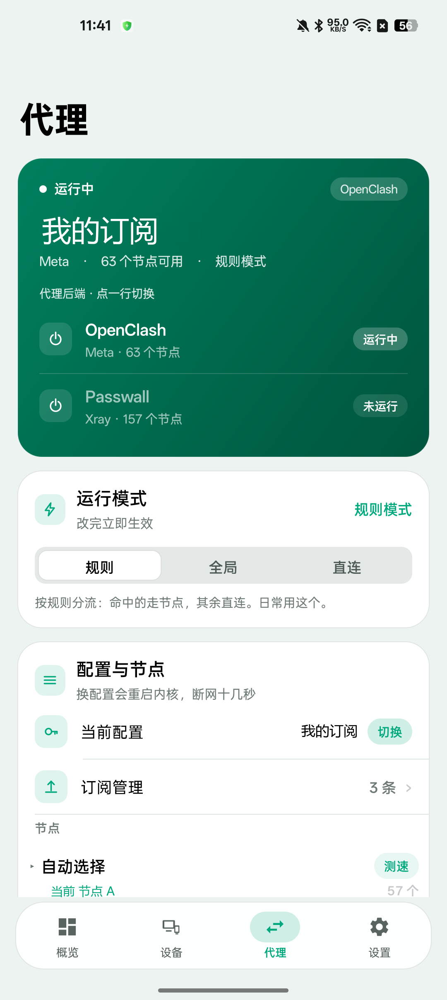
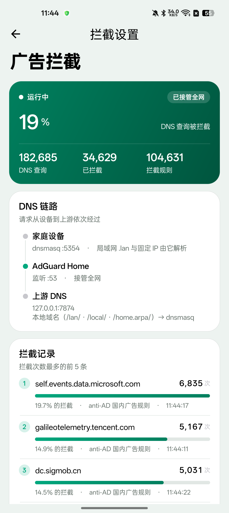
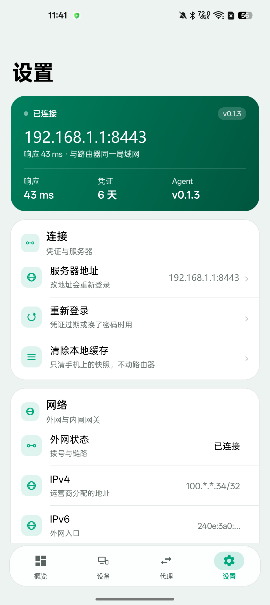
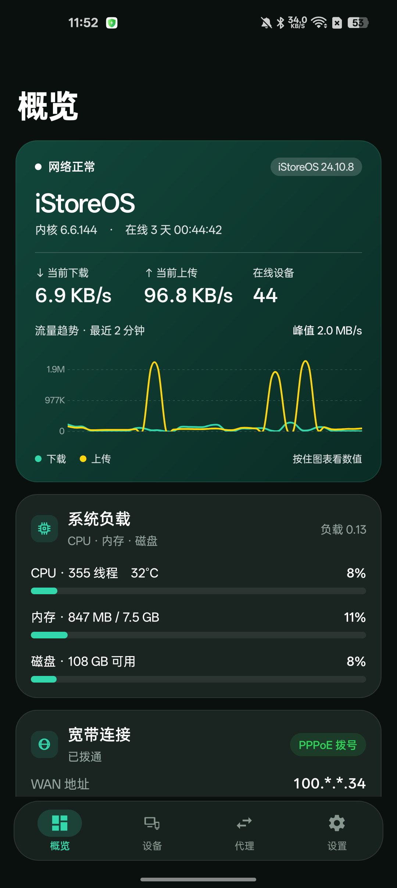

# iStore Pilot



**iStoreOS / OpenWrt 路由器的原生管理客户端，外加一个跑在路由器上的轻量 Agent。**

手机上装 App，局域网或外网直连路由器，看实时状态、管设备、切代理节点、查拦截日志。
界面是纯原生的（Java / ArkTS / SwiftUI），不是 WebView 套壳。

```
┌──────────────┐        HTTP :8443         ┌─────────────────┐
│  三端客户端   │ ────────────────────────> │  istore-agent   │
│ Android      │      /api/v1/*            │  (Python 3)     │
│ HarmonyOS    │ <──────────────────────── │                 │
│ iOS          │        JSON               └────────┬────────┘
└──────────────┘                                   │ ubus / uci / nft / procfs
                                          ┌────────▼────────┐
                                          │   iStoreOS 本体  │
                                          │ OpenClash / AGH │
                                          └─────────────────┘
```

---

## 快速开始

到 [**Releases**](https://github.com/zifeng-chen/istore-pilot/releases) 下载，按需要选：

| 文件 | 装在哪 | 说明 |
|---|---|---|
| `istore-pilot_0.1.3-1.run` | 路由器 | **推荐**。单文件，`sh` 一下就装完，不用 opkg、不用联网 |
| `luci-app-istore-agent_0.1.3-1_all.ipk` | 路由器 | 传统方式，走 opkg（软件包页面上传安装） |
| `istoreos-0.1.3.apk` | Android 手机 | 连路由器用 |
| iOS / 鸿蒙 | — | 暂未提供安装包，按 [六、构建](#六构建与打包) 自行编译 |

`.run` 按架构分了四份（`_x86_64` / `_arm64` / `_armv7` / 无后缀的通用版）。
载荷是纯 Python，四份内容一致，只是包名不同、`--check` 时会对一下 `uname -m`。

路由器端，两种方式**选一种**：

```sh
# 方式 A：.run（推荐）—— 把文件传到路由器后执行
sh istore-pilot_0.1.3-1_x86_64.run --check    # 先只检查环境与架构，不改任何文件
sh istore-pilot_0.1.3-1_x86_64.run            # 安装或升级，保留现有配置

# 方式 B：ipk
opkg update && opkg install python3
opkg install luci-app-istore-agent_0.1.3-1_all.ipk
```

`.run` 的其它用法：

```sh
sh istore-pilot_0.1.3-1.run --uninstall   # 卸载程序，保留密码与配置
sh istore-pilot_0.1.3-1.run --purge       # 卸载并清除全部配置
sh istore-pilot_0.1.3-1.run --force       # 已用 opkg 装过时，改由本包接管
```

装完打开 `http://<路由器IP>:8443`。首次安装的随机密码在路由器上查看：

```sh
cat /etc/istore-agent/INITIAL_PASSWORD
```

Android：装 APK，或者直接在装好插件的路由器上下载
`http://<路由器IP>/istore-agent/istoreos-0.1.3.apk`（插件自带这个文件）。

> `.run` **不会改动任何网络、防火墙、DHCP、DNS 配置**，装的过程中现有网络不受影响。
> 已有 `/etc/config/istore-agent` 时一律保留，不会把 `bind` 覆盖成 `0.0.0.0`。

详细说明见 [`docs/install.md`](docs/install.md)。

---

## 一、项目主旨

路由器自带的管理后台是给「配置」用的，不是给「查看」用的。

日常最想知道的几件事 —— 现在网速多少、谁在占带宽、这台设备是什么、代理走没走、
今天拦了多少广告 —— 都埋在好几层菜单里，手机上打开还很别扭。第三方 App 要么只支持
OpenWrt 原版，要么读不到 OpenClash 和 AdGuard Home 的内部状态。

iStore Pilot 想做的是**一个合格的手机端仪表盘**：

- **快**：进去就有数，不是先转圈再出数
- **准**：数字来自内核和服务的真实状态，不是估算
- **像原生**：手势、动画、深色模式都跟系统一致，不是网页套壳
- **不越权**：只读为主，改配置一律走「确认 + 超时自动回滚」

一句话：**把路由器的状态，做成手机上能一眼看懂的东西。**

## 二、它解决什么问题

| 痛点 | iStore Pilot 的做法 |
|---|---|
| 后台层层菜单，手机上难用 | 四个页签：概览 / 设备 / 代理 / 设置，一屏看完 |
| 设备列表只有 IP 和 MAC，看不出是谁 | 4 万条 OUI + 主机名规则识别品牌、类型、型号，显示「绿米 · 插座 · Aqara」 |
| 开了 OpenClash 后全是 `198.18.x.x` fake-ip | 从 Clash `/connections` 的 `metadata.sourceIP` 反查 `host`，还原真实域名 |
| 设备关屏后显示离线 | 在线判定四路交叉（邻居表 / 字节增长 / conntrack / 主动 ping），不再误报 |
| 不知道哪个 App 在吃流量 | 18 万条域名特征库反推应用，路由器在转发路径上拿不到进程信息 |
| 改网络配置断网只能靠重启救 | 配置事务：60 秒内不确认自动回滚，客户端永远能回来 |
| 只支持 OpenWrt 原版 | OpenClash 与 Passwall 双后端抽象，同一套接口 |

## 三、系统架构

三端不直接接触路由器，所有能力由 Agent 统一暴露成 `/api/v1/*`：

- **Agent**（`agent/`）跑在路由器上，Python 3 标准库，零第三方依赖。
  它把 `ubus` / `uci` / `nft` / `procfs` / `/tmp/dhcp.leases` 这些底层数据源，
  整理成一份稳定的 JSON 契约。
- **客户端**（`android/` `harmony/` `ios/`）只认这份契约。三端看到的数据必然一致，
  因为它们请求的是同一份。
- **Web 控制台**（`web/`）是同一套接口的浏览器版（PWA），给不想装 App 的场景。

这样设计的好处是：换代理后端、改数据源、加字段，只动 Agent，
三端不需要各改一遍。

详细设计取舍见 [`docs/architecture.md`](docs/architecture.md)。

## 四、功能

四个底部页签，加若干二级页：

| 页面 | 内容 |
|---|---|
| **概览** | 主机名/系统/内核/在线时长；实时上下行与 2 分钟曲线；CPU·内存·磁盘三根进度条；负载、温度、线程数；WAN 状态与地址；网口状态 |
| **设备** | 在线/总数/已禁网；今日拦截与实时总流量；搜索；在线离线分组，按实时流量排序；内嵌应用流量与广告拦截两张卡 |
| 　└ 设备清单 | 全部设备，带 `5G` / `2.4G` / `有线` 徽标（来自 AP 接入表，不是猜的） |
| 　└ 设备详情 | 品牌/类型/型号；实时上下行 + 累计流量；正在访问的域名（带代理链和命中规则）；连接明细；改备注 / 禁网 / 固定 IP / 唤醒 |
| 　└ 应用流量 | 按 App 汇总近 5 天用量，77 个官方图标；从域名特征反推，路由器看不到进程名也能认 |
| 　└ 广告拦截 | 拦截率、查询次数、规则数；**DNS 链路图**（家庭设备 → dnsmasq → AGH → 上游）；拦截 Top 5；规则与更新；接管全网 / 退出接管 |
| **代理** | OpenClash 与 Passwall 谁在跑；引擎与节点数；规则/全局/直连一键切换；节点分组折叠 + 一键测速；配置文件切换；订阅管理 |
| **设置** | 连接信息与响应延迟；服务器地址 / 重新登录 / 清缓存；WAN 与 LAN 明细（含 IPv6 全局地址）；外观与刷新率；配置备份与恢复；固件与软件包更新 |

有两处是别的客户端不做的：

- **AP 未安装时的一键安装**：拦截页在 `installed=false` 时给一个按钮，二次确认后
  由 Agent 在路由器上 opkg + 下载本体 + 初始化向导 + 加规则，客户端只看进度条。
  全程不碰 53 端口，装完是「观察模式」，接管仍要你另外点一次。
- **DNS 兜底巡检**：接管后每 12 秒看一眼 53 有没有人应答，没有就把 dnsmasq 放回去。
  宁可丢拦截，不能丢网。

## 五、仓库结构

三端源码各自独立成顶层目录，互不嵌套，任何一端都可以单独 clone / 单独构建。

```
istoreOS/
├── android/          Android 客户端      Java + AndroidX/Material
├── harmony/          HarmonyOS NEXT      ArkTS + ArkUI（Stage 模型）
├── ios/              iOS 客户端          SwiftUI，无 WebView
├── agent/            路由器端 Agent      Python 3 标准库，零依赖
├── web/              浏览器控制台        HTML/CSS/JS（PWA）
├── deploy/           ipk 打包与部署      Python + shell
├── scripts/          构建/版本/运维脚本   Python + shell
├── docs/             文档与成品截图
└── dist/             构建产物（不入库，.gitignore 已排除）
```

| 模块 | 文件数 | 行数 |
|---|---:|---:|
| `agent/` | 24 个 .py | 10,531 |
| `android/` | 47 个 .java | 15,939 |
| `harmony/` | 31 个 .ets | 9,283 |
| `ios/` | 26 个 .swift | 7,963 |
| `web/` | 2 个 .js | 847 |
| `deploy/` + `scripts/` | 38 个 .py | 5,848 |

## 六、构建与打包

三端共用同一个版本号（见 [九、版本管理](#九版本管理)），但构建链完全独立 ——
任何一端都能单独 clone、单独出包，互不依赖。

### Android

```bash
export JAVA_HOME="<JDK 17>"
export ANDROID_HOME="<Android SDK>"
export JAVA_TOOL_OPTIONS="-Dfile.encoding=UTF-8"   # 中文文案必须锁 UTF-8，否则按 GBK 编译成乱码
cd android
gradle assembleRelease
```

产物 `app/build/outputs/apk/release/app-release.apk`，当前 **2.57 MB**。
minSdk 24 / targetSdk 34。

release 已开 **R8 + 资源收缩**（`minifyEnabled true` + `shrinkResources true`）。
开之前必须确认三件事，否则会在运行时崩：

| 前提 | 为什么 |
|---|---|
| 没有反射（`Class.forName` / `getDeclaredMethod`） | keep 规则写不全就会 `ClassNotFoundException` |
| 布局里没有自定义 View 的全限定名 | 这类类不会被自动 keep，inflate 时直接崩 |
| 图标是静态 `R.drawable.*` 引用，不是 `getIdentifier` | 按名字取资源时，收缩会把图标删成占位块 |

签名需要 `android/keystore.properties` 与 `android/istoreos.keystore`，
**两者都不入库**（`.gitignore` 已排除），格式见 [`docs/clients.md`](docs/clients.md)。

### HarmonyOS

工程是 **Stage 模型 + ArkTS**，用 DevEco Studio 自带的 hvigor 构建
（不需要 Gradle，也不需要 Mac）：

```bash
cd harmony

# 一次性：让 DevEco 补齐 hvigor 插件版本（写在 hvigor-config.json5 里会跟 SDK 对不上）
hvigorw --sync

# 出包
hvigorw --mode module -p product=default -p buildMode=release assembleHap --no-daemon
```

产物 `entry/build/default/outputs/default/entry-default-unsigned.hap`（约 2.5 MB）。

签名是**装不上的唯一门槛**：`build-profile.json5` 里的 `signingConfigs` 是空数组，
证书要在 AppGallery Connect 上按自己的 `bundleName` 申请 `p12 + cer + p7b`，
再在 DevEco 的 Signing Configs 里勾一次。本仓库现成的 p7b 绑的是别的包名，
所以产物只能是 `unsigned`，`hdc install` 会拒绝。

其它三条不能动的配置：

- `resources/base/profile/network_config.json` 的 `cleartextTrafficPermitted: true`
  —— 接口是明文 HTTP `:8443`，去掉直接连不上
- 新增页面必须在 `resources/base/profile/main_pages.json` 里登记，光有 `@Entry` 不够
- 图标用 `Path` 指令画，遇到圆弧（`A`）会被截断成一个点；用
  `python scripts/harmony_icon_paths.py --check` 扫

### iOS

纯 SwiftUI，工程文件由脚本生成 —— **`project.pbxproj` 不要手改**：

```bash
cd ios
python gen_project.py        # 增删 .swift 之后必须重跑，否则报 cannot find X in scope

xcodebuild -project IStorePilot.xcodeproj -scheme IStorePilot \
           -configuration Release -destination 'generic/platform=iOS' \
           -archivePath build/IStorePilot.xcarchive archive

# 只有 archive 还不够，出 IPA 要再导一次
xcodebuild -exportArchive -archivePath build/IStorePilot.xcarchive \
           -exportPath build/ipa -exportOptionsPlist ExportOptions.plist
```

第二条命令需要 `ExportOptions.plist` 里写明 `teamID` 和 `provisioningProfiles`，
也就是必须先有一个描述文件。**当前这一环是缺的** —— 仓库里有 1 张
Apple Development 证书、0 个描述文件，所以只能编译/归档，导不出可安装的 IPA。
自己跑的话，Xcode 里选一次 Team（免费 Apple ID 也行，7 天有效）就能导出。

`Info.plist` 已放开 `NSAllowsArbitraryLoads`（明文 8443）与
`NSLocalNetworkUsageDescription`（iOS 14+ 访问局域网要授权）。

### 一条命令发版

APK 更新后不要手动重打包，跑这个：

```bash
python scripts/release.py            # 全流程
python scripts/release.py --dry-run  # 只看会做什么
python scripts/release.py --notes 说明.md
python scripts/release.py --update-notes   # 只改已发布 Release 的正文
```

它依次做：同步 `app-release.apk` → `dist/` → 重打四份 `.run` → commit/push →
打 tag → 建 Release 并上传 5 个资产。

> **坑**：`.run` 里的 APK 是按 **文件修改时间**从 `dist/` 挑最新的，不认「你刚编译过」。
> 只跑 `build_run.py` 而没先把 APK 复制进 `dist/`，发出去的就是旧 App。脚本里已经替你做掉这步。

## 七、部署 Agent

Agent 是一组 Python 文件，只依赖标准库，路由器自带 Python 3.11 就能跑。

```bash
export ROUTER_PW='<路由器 SSH 口令>'
python deploy/deploy.py            # 开发期：直接推文件 + 重启服务
```

正式安装有两条路，**装的是同一份文件**（`.run` 直接复用 `build_ipk.py` 的暂存逻辑）：

```bash
# A. .run 自解压包（推荐，用户装就这一个文件）
python deploy/build_run.py                 # 一次出四份：x86_64 / arm64 / armv7 / all
python deploy/build_run.py --arch=arm64    # 只出指定架构
python deploy/build_run.py --no-apk        # 不含 APK，小 2.6 MB

# B. ipk（走 opkg，可被「软件包」页面管理）
python deploy/build_ipk.py                 # 产出 dist/luci-app-istore-agent_<版本>_all.ipk
python deploy/build_ipk.py --with-apk      # 顺带把 APK 塞进包内，网页端可直接下载
ROUTER_PW='...' python deploy/install_ipk.py
```

装完在 LuCI「服务 → iStore Pilot」里能看到运行状态、改端口、下载 App。

> ### ⚠️ 三件必须注意的事
>
> **1. 监听地址**：Agent 默认 `0.0.0.0:8443`。如果不打算走公网访问，
> 请把 `/etc/config/istore-agent` 的 `bind` 改成 LAN 地址
> （例如 `192.168.1.1`），避免管理面暴露在 WAN / IPv6 公网侧。
>
> **2. 打包顺序**：`build_ipk.py` 直接从项目根 `web/` 复制前端资源。
> 先打包后改 web，会导致包内永远是旧文件，装完还会把手工上传的新文件覆盖回去。
> **正确顺序：改代码 → build_ipk / build_run → install。**
>
> **3. `.run` 与 ipk 互斥**：两种装法不能并存，否则 `opkg remove` 会把 `.run`
> 装进去的程序文件一起删掉，而 opkg 记录里还写着「已安装」，后续升级彻底错乱。
> `.run` 检测到 opkg 包时会拒绝执行，需要显式 `--force` 才接管。

## 八、配置与口令

仓库里**不含任何真实口令**。所有敏感值都从环境变量注入：

| 变量 | 用途 | 谁用 |
|---|---|---|
| `ROUTER_PW` | 路由器 SSH 口令 | `deploy/deploy.py`、`scripts/rsh.py`、各 `check_*.py` |
| `AGENT_PASSWORD` | Agent 登录口令（留空则沿用 `ROUTER_PW`） | `deploy/deploy.py` |
| `AGENT_ADGUARD_PASSWORD` | AdGuard Home 管理口令 | `agent/config.py` 默认值 |
| `AGH_PW` | AGH 明文口令 | `scripts/agh_*.sh` |
| `AGH_PWHASH` | AGH 的 bcrypt 口令哈希 | `scripts/agh_password.sh` |
| `ROUTER_HOST` / `ROUTER_PORT` / `ROUTER_USER` | SSH 目标 | 部署与运维脚本 |

`deploy/AdGuardHome.yaml` 里的 `password` 是占位符，部署前需换成自己的 bcrypt 哈希：

```bash
htpasswd -bnBC 10 "" '你的口令' | tr -d ':\n' | sed 's/$2y/$2b/'
```

Agent 自己的配置文件在 `/etc/istore-agent/config.json`，可用
`ISTORE_AGENT_CONFIG` 环境变量指向别处（便于本地调试）。

### 接入方式（有线 / 无线）的数据来源

「这台设备是插网线还是连 WiFi」**软路由自己看不到** —— AP 是桥接的，
无线和有线都桥到同一根网线（`brctl showmacs br-lan` 里所有 MAC 都在同一个 port）。
唯一的准确来源是 AP 的接入设备表，所以要配一段：

```json
"ap": {
  "enabled": true,
  "driver": "zte",                  // 目前只有 zte（中兴 ZXSLC 系列）
  "user": "admin",
  "password": "你的 AP 管理口令",
  "hosts": ["192.168.1.165"]      // Mesh 的话把主、从都写进来
}
```

- 配了：设备列表显示 `无线 2.4G` / `无线 5G` / `有线`，是事实
- 没配、换了别的牌子、口令错：自动退回「私有 MAC + 设备类型」推断，
  显示 `无线(推测)`；推断不出来的不显示。**不会误报**，也不会因为 AP 换了就崩
- 硬失败（口令错 / 不是这个牌子 / 地址不通）连撞三次就退到 30 分钟一轮，
  不会拿别人的路由器当靶子打

要接新厂商（TP-Link / 小米 / OpenWrt…）：照 `agent/zte.py` 的样子写一个模块，
暴露 `settings() / ensure() / access_map() / status()` 四个函数，
再到 `agent/ap.py` 的 `DRIVERS` 里登记一行即可，上层和客户端都不用改。
各家差异只有「怎么登录、客户端列表长什么样」这一步。

## 九、版本管理

三端 + Agent 共用一个版本号：

```bash
python scripts/bump_version.py          # 看当前版本与下一位
python scripts/bump_version.py --next   # 自增并同步六处
python scripts/check_version.py         # 校验六处是否一致（提交前跑）
```

规则：`0.1.0` 起，**第三位满 10 进位到第二位**（没有 `0.1.10`，是 `0.2.0`）。
`versionCode` 单调递增、与语义版本解耦 —— Android 不接受版本号回退。

`bump_version.py` 同步的六个位置：`agent/server.py`、`android/app/build.gradle`、
`ios/gen_project.py`、`harmony/AppScope/app.json5`、`harmony/oh-package.json5`、
`harmony/entry/oh-package.json5`。

最后两个容易被忘 —— 它们是 hvigor 写进产物清单的字段，不跟着改会出现
「`app.json5` 写 0.1.3、HAP 清单里写别的」，排查起来很费时间。改完 ios 的还要
再跑一次 `python ios/gen_project.py`。

当前版本见 [`CHANGELOG.md`](CHANGELOG.md)。

## 十、界面

全部是真机截图（1080×2412），不是效果图。截图里的设备名、内网地址、订阅名
已用 [`scripts/mask_shots.py`](scripts/mask_shots.py) 换成中性值，
处理方式是「原位重绘」而不是打码块。

| | | |
|---|---|---|
|  |  |  |
| 概览：实时速率、2 分钟曲线、负载 | 设备：在线统计、接入方式徽标 | 代理：双后端、规则/全局/直连 |
|  |  |  |
| 广告拦截：DNS 链路与拦截 Top 5 | 设置：连接延迟、WAN/LAN 明细 | 深色模式（跟随系统） |

## 十一、已知限制

写在这里，省得你试了才发现：

| 限制 | 原因 | 有没有救 |
|---|---|---|
| iOS / 鸿蒙没有现成安装包 | 缺描述文件（iOS）、HAP 未签名（鸿蒙） | 自己编译，见上一节 |
| 禁网不会断掉已建立的连接 | `src_mac + REJECT` 只拦新连接 | 无（内核层做不到，除非 conntrack 清理） |
| 不能限速 | 固件没装 `tc` | 装 `tc` 后可加 |
| 看不到 Wi-Fi 信号强度 | 软路由没有无线网卡 | 无 |
| 接入方式依赖 AP | 只有中兴（ZXSLC 系列）驱动；从节点读不到客户端表 | 驱动可插拔，见第八节 |
| 改 WAN / 切代理后端会断网 | 重拨或重启内核，10–30 秒 | 有 60 秒自动回滚，但断网是真的 |
| 接管全网 DNS 后 AGH 是单点 | 53 端口只有它在听 | 12 秒巡检自愈，退回观察模式 |

## 十二、文档

| 文档 | 内容 |
|---|---|
| [`CHANGELOG.md`](CHANGELOG.md) | 更新日志，逐版本记录 |
| [`docs/install.md`](docs/install.md) | 路由器端安装详解：`.run` 与 ipk 两种方式、卸载、排错 |
| [`docs/architecture.md`](docs/architecture.md) | 架构与关键设计决策、踩过的硬坑 |
| [`docs/api.md`](docs/api.md) | Agent 接口参考 |
| [`docs/clients.md`](docs/clients.md) | 三端打包、签名、安装与真机调试 |
| [`PLAN.md`](PLAN.md) | 功能规划与早期设计取舍 |
| `harmony/README.md`、`ios/README.md` | 各端工程内说明（目录结构、平台差异、坑） |

## 十三、许可

未指定许可证。代码公开可见，但未授予使用、修改、分发许可，如需引用请联系作者。
